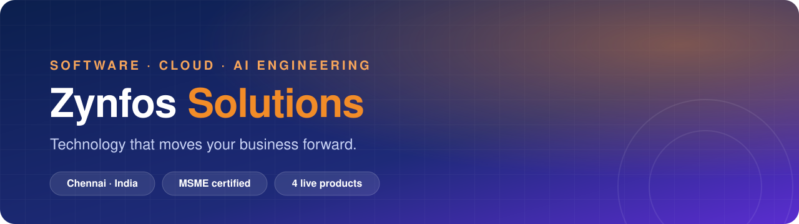
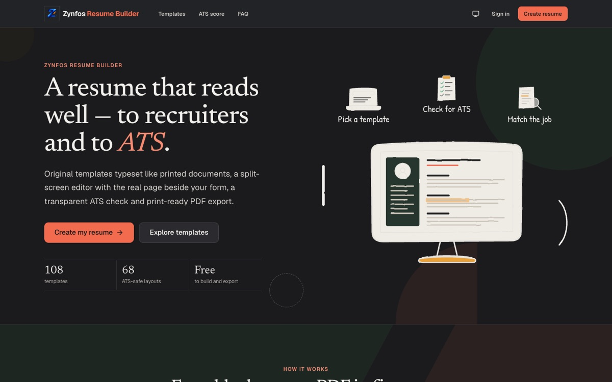
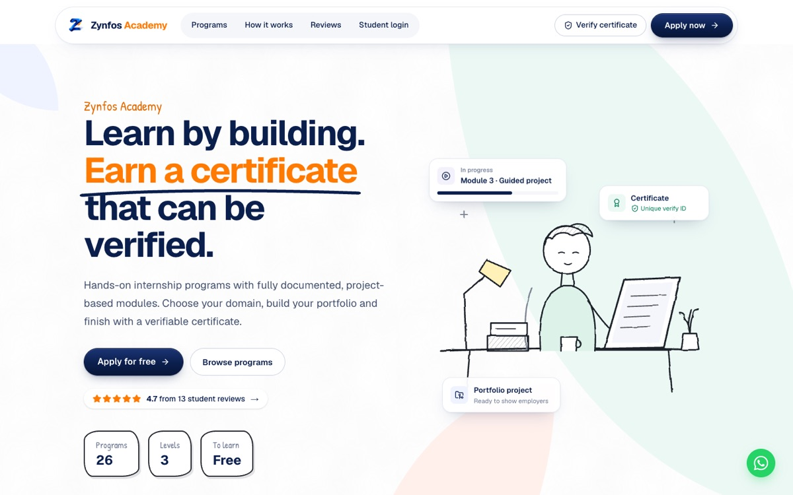
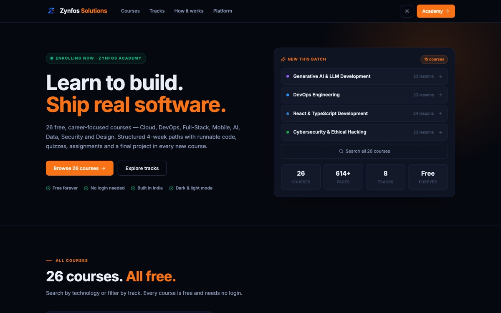
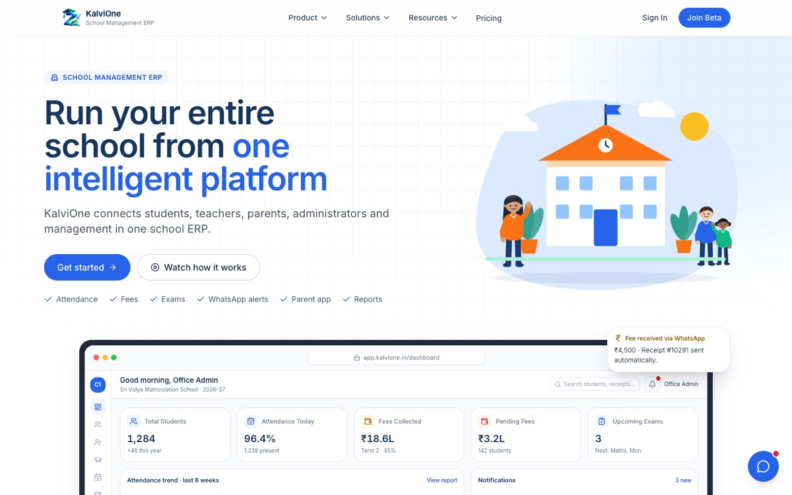

<div align="center">

<a href="https://zynfos.com"></a>

<br />

<a href="https://zynfos.com"></a>
<a href="https://zynfos.com/portfolio"></a>
<a href="https://zynfos.com/contact"></a>

<br /><br />

We design, build and support **custom software, mobile apps, cloud platforms and AI automation** for growing businesses across India and beyond. One accountable team from the first call to long-term support.

</div>

<br />

## ◆ Products we've built and run

<table>
  <tr>
    <td width="50%" valign="top">
      <a href="https://resumebuilder.zynfos.com"></a>
      <h3><a href="https://resumebuilder.zynfos.com">Resume Builder</a></h3>
      <p>A resume that reads well to recruiters <i>and</i> to ATS. Split-screen editor with the real page beside your form, 108 templates, transparent ATS scoring, job matching and print-ready PDF export.</p>
      <sub><b>Next.js · TypeScript · PostgreSQL · Puppeteer</b></sub>
    </td>
    <td width="50%" valign="top">
      <a href="https://academy.zynfos.com"></a>
      <h3><a href="https://academy.zynfos.com">Zynfos Academy</a></h3>
      <p>Learn by building. Hands-on internship programs with fully documented, project-based modules, a student dashboard and certificates anyone can verify online.</p>
      <sub><b>Next.js · Node.js · PostgreSQL</b></sub>
    </td>
  </tr>
  <tr>
    <td width="50%" valign="top">
      <a href="https://course.zynfos.com"></a>
      <h3><a href="https://course.zynfos.com">Developer Courses</a></h3>
      <p>26 free, career-focused courses across Cloud, DevOps, Full-Stack, Mobile, AI, Data, Security and Design. No login, runnable code, a final project in every course.</p>
      <sub><b>Next.js · Node.js · PostgreSQL</b></sub>
    </td>
    <td width="50%" valign="top">
      <a href="https://kalvione.tech"></a>
      <h3><a href="https://kalvione.tech">KalviOne</a></h3>
      <p>Run an entire school from one platform. Attendance, fees, exams, reports, a parent app and WhatsApp alerts, connecting students, teachers, parents and management.</p>
      <sub><b>Next.js · Python · PostgreSQL</b></sub>
    </td>
  </tr>
</table>

<br />

## ◆ What we do for clients

| | Service | |
|:-:|---|---|
| 💻 | **Software & Web Development** | Custom platforms, dashboards and business websites |
| 📱 | **Mobile App Development** | iOS and Android from one codebase |
| 🤖 | **AI & Business Automation** | Practical AI and workflows, introduced where they pay off |
| ☁️ | **Cloud Infrastructure** | CI/CD, monitoring and zero-downtime releases |
| 🎨 | **UI/UX Design** | Clickable prototypes before a line of code |
| 🧭 | **IT Consulting** | Architecture reviews, codebase audits, technical roadmaps |

<br />

## ◆ How we work

```
Discover  →  Design  →  Develop  →  Test  →  Deploy  →  Support
 30-min      Click-      Weekly      QA on     CI/CD,     Monitoring,
 free call   through     demos       every     no         fixes and
             prototypes              device    downtime   new features
```

<br />

## ◆ Our stack

<p>


</p>

<br />

## ◆ Let's build something

<table>
  <tr>
    <td><b>✉️ Email</b></td><td><a href="mailto:info@zynfos.com">info@zynfos.com</a></td>
  </tr>
  <tr>
    <td><b>📞 Phone</b></td><td>+91 73585 91507 · Mon to Sat, 9 AM to 7 PM IST</td>
  </tr>
  <tr>
    <td><b>📍 Location</b></td><td>Chennai, Tamil Nadu · hybrid</td>
  </tr>
  <tr>
    <td><b>🔗 Social</b></td><td><a href="https://www.linkedin.com/company/zynfos-solutions/">LinkedIn</a> · <a href="https://www.instagram.com/zynfos/">Instagram</a></td>
  </tr>
</table>

<div align="center">
<br />
<a href="https://zynfos.com"></a>
<br />
<sub>© Zynfos Solutions · MSME certified, Government of India</sub>
</div>
